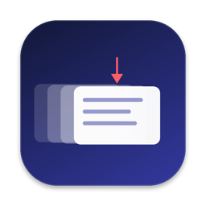
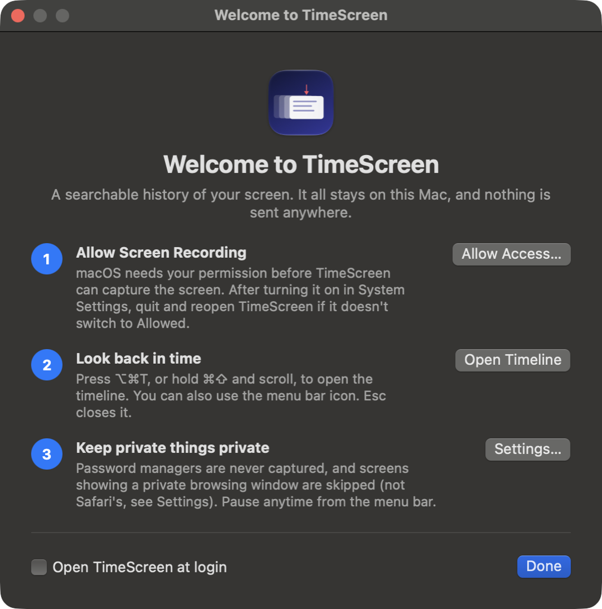
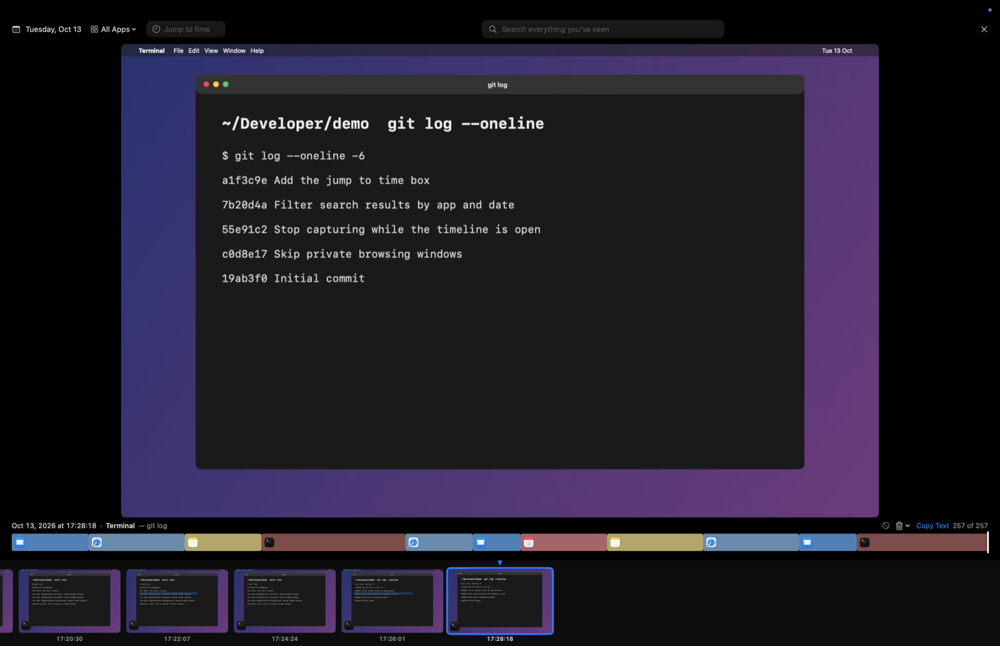
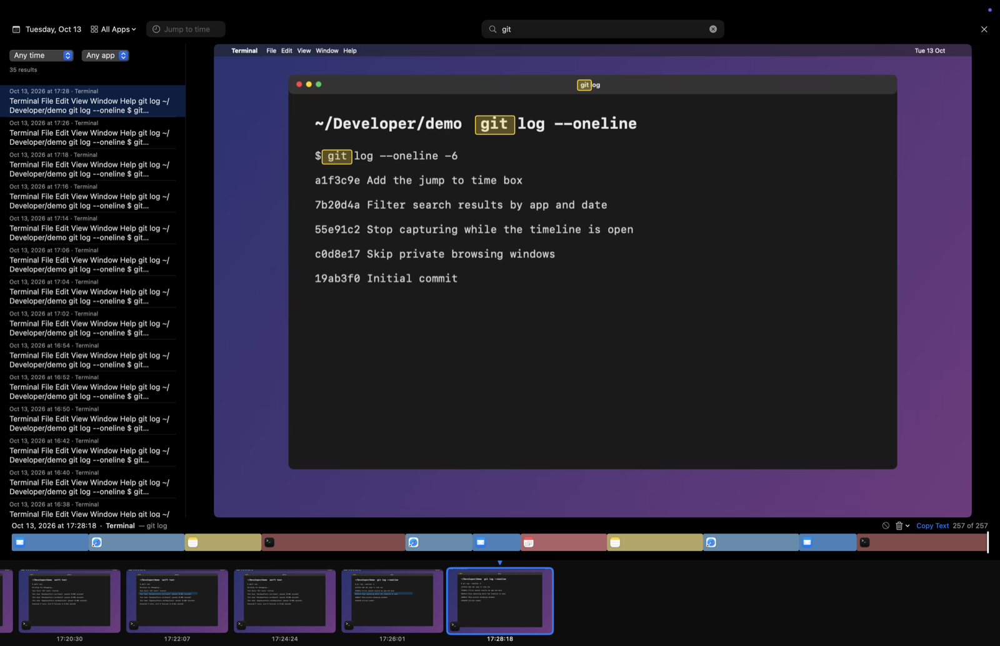
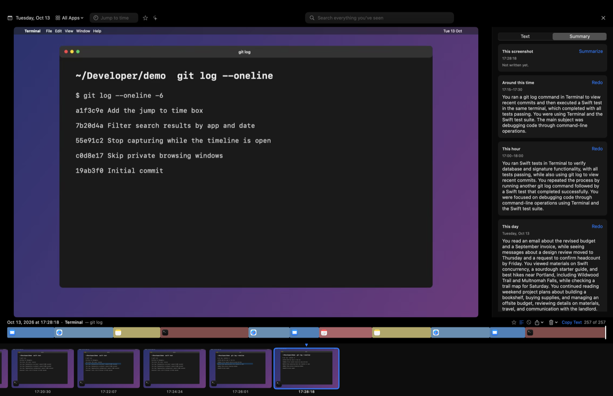
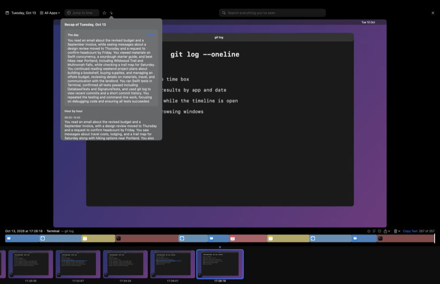

<p align="center">
  
</p>

<h1 align="center">TimeScreen</h1>

<p align="center">
  A searchable history of your screen for macOS, like Rewind, with recaps written by on-device Apple Intelligence. Everything stays on your Mac.
</p>

<p align="center">
  
  
</p>

> Largely AI-written (see [AI-DISCLOSURE.md](AI-DISCLOSURE.md)). Not affiliated with Rewind. The screenshots here use
> made-up data.

---

TimeScreen lives in the menu bar and takes a screenshot every few seconds. Press a shortcut and the whole screen turns into
a timeline you can scroll through, search and copy text from. It reads the text in each screenshot with Apple's on-device
text recognition, and can write short summaries of a screenshot, a stretch of time, an app or a whole day with on-device
Apple Intelligence (macOS 26 or later). Nothing is ever sent off your Mac.

## Features

| Feature | What it does |
|---|---|
| **Capture** | Every display, every 2 to 60 seconds (5 by default), skipping frames where nothing changed. Stored as HEIC; screenshots older than a day are shrunk to save space |
| **Timeline** | A full-screen filmstrip you scrub by scrolling anywhere. A colored bar shows which app you were in all day, with its icon. Pick days from a calendar, filter by app, or type a time (`3:45pm`, `15:30`, `noon`) into **Jump to time** |
| **Search** | Search everything you've seen, filtered by date range or app. Words match from the start, `"quotes"` match an exact phrase and `-word` leaves one out. Matches are highlighted on the screenshot, and ↑ ↓ step through the results |
| **Starred moments** | Press **S** (or use the star) to keep a screenshot forever. Starred ones are never deleted by retention or the size limit, show up as yellow marks on the activity bar, and are listed under the star in the top bar. A global **Star Moment** shortcut and a menu bar item star whatever is on screen now |
| **Zoom** | Pinch, or ⌘+ ⌘− ⌘0, to zoom into a screenshot toward the pointer. Drag to select text, hold ⇧ and drag to move around |
| **Summaries** | Short recaps of a screenshot, a 15-minute stretch, an hour, a day or one app's day, written by on-device Apple Intelligence (macOS 26 or later). See [Summaries](#summaries) |
| **Text panel** | Press **T** to show the text recognized in the current screenshot beside it, with your search words highlighted |
| **Copy text** | Drag a box over a screenshot and press ⌘C to copy the words in it, or copy all the text in the frame |
| **Privacy** | Password managers are never recorded. Screens showing a private browsing window are skipped. Optional **Touch ID or password lock** on the timeline. One click to never record an app |
| **Export** | Save a screenshot or a whole day as a folder with a Markdown transcript, in your choice of **Most Compatible** (JPEG), **High Efficiency** (HEIC) or **Best Quality** (PNG, lossless; screenshots are stored compressed, so it keeps what is stored without losing more). Copy an image, or save its text. Search results export as a transcript too |
| **Delete** | Delete the frame you're looking at, the last 5, 15 or 60 minutes (also from the menu bar), or a whole day |
| **Storage** | Keep history from 7 days to forever, with a size limit (20 GB by default) that deletes the oldest screenshots first |
| **Power** | Optionally pauses on battery power or in Low Power Mode, and always when less than 1 GB of disk space is free |
| **Updates** | Updates itself with [Sparkle](https://sparkle-project.org); updates are signed |

<p align="center">
  
</p>

## Summaries

<p align="center">
  
  
</p>

Open the **Summary** tab beside a screenshot (press **T**, then choose Summary) to write a recap of:

| Summary | What it covers |
|---|---|
| **This screenshot** | One request, on demand |
| **Around this time** | The 15-minute stretch it belongs to |
| **This hour** | Built from that hour's 15-minute stretches |
| **This day** | Built from the day's hours |
| **An app's day** | Everything you did in that app that day |

The sparkles button in the top bar opens a **day recap**, hour by hour. Summaries are written on this Mac by on-device Apple
Intelligence from the text TimeScreen already read, never from the image, and they are saved in your index and deleted along with
the screenshots they cover.

How it works, and its limits:

- Apple Intelligence reads about 8,000 tokens at a time, but a recap only gets about 2,000 of them (roughly 6,000 characters): reading the input is
  most of the time a request takes, and more text barely improves a one- or two-sentence recap. A stretch of many screenshots is boiled down
  first, dropping lines that repeat on most of them, like menu bars and sidebars. On a typical Mac that is about 2 to 3 seconds per
  15-minute stretch and under 2 for an hour.
- By default TimeScreen writes finished 15-minute stretches and hours **in the background**, only while the Mac is idle and plugged in
  (not in Low Power Mode), stopping as soon as you use it. A day's recap then just puts the hours together. You can turn this off in
  Settings ▸ Summaries; without it, summarizing a whole day from scratch takes a couple of minutes.
- Summaries can be wrong, or thin when a screen has little text. They need macOS 26 or later with Apple Intelligence turned on.

## Install

Download the zip from [Releases](https://github.com/thebitstick/TimeScreen/releases) and move **TimeScreen.app** into
Applications (or `~/Applications`). It isn't notarized, so on first launch Control-click it and choose **Open**. macOS 14 or
later. A welcome window walks you through allowing **Screen Recording**.

## Using it

| Action | How |
|---|---|
| Open the timeline | **⌥⌘T** (changeable, or removable, in Settings ▸ Shortcuts), the menu bar icon, or hold **⌘⇧** and scroll |
| Move | Scroll anywhere, or **← →** (**⇧** for 10 frames). **⌥← ⌥→** jump to the previous or next app switch, **⌘← ⌘→** (or **Home** and **End**) to the first and last frame |
| Search | **⌘F** or **/** focuses the search box. **↑ ↓** step through results and **Return** hands focus back |
| Text and summaries | **T** shows or hides the side panel, which has a Text tab and a Summary tab |
| Zoom | Pinch, or **⌘+ ⌘− ⌘0**. Drag to select text, hold **⇧** and drag to move |
| Star | **S** stars or unstars the current screenshot |
| Close | **Esc** |
| Pause | Menu bar ▸ Pause Recording, or Pause For 15 minutes, 1 hour or 8 hours. You can also set a global **Pause / Resume** shortcut in Settings ▸ Shortcuts, which plays a short sound |

The menu bar icon shows the state: recording, paused, a private window or power setting is stopping capture, the disk is
almost full, or Screen Recording access is missing. While Settings or the Welcome window is open, TimeScreen also shows a Dock
icon, which macOS needs for it to bring those windows to the front.

## Privacy and safety

- **Nothing leaves your Mac.** The only network traffic is Sparkle checking GitHub for a new version, which you can turn off in
  Settings ▸ General. Summaries use Apple's **on-device** model only; the cloud model macOS 27 also offers is never used.
- Summaries can be wrong, and a screen with little text gives thin ones. They are written from the recognized text alone, never from
  the image, so check the screenshot for anything that matters.
- Screenshots and the search index are stored **unencrypted** in `~/Library/Application Support/TimeScreen`. Turn on FileVault
  to protect them at rest. The timeline lock only guards the timeline, not those files.
- TimeScreen never records its own windows, the timeline while it is open, a locked or sleeping Mac, or apps on the
  never-capture list (1Password, Keychain Access, Passwords and Bitwarden by default).
- Private windows are recognized by title words (Incognito, InPrivate, Private Browsing, Private Window), which you can edit.
  **Safari doesn't mark private windows in their titles, so they can't be detected.** Add Safari to the never-capture list or
  use Pause For before browsing privately there.
- If something private did get recorded, delete it from the trash menu in the timeline or from **Delete Recent** in the menu bar.

## Troubleshooting

- **Nothing is being captured / the icon shows a triangle:** turn TimeScreen on in System Settings ▸ Privacy & Security ▸
  Screen & System Audio Recording, then quit and reopen it. macOS asks again after an update, because releases are signed
  ad hoc rather than with a developer certificate.
- **The timeline doesn't open:** check the shortcut in Settings ▸ Shortcuts (another app may use it) and, if you turned on the
  timeline lock, that you can authenticate.
- **Summaries are slow:** Apple Intelligence writes one at a time, a few seconds each, and a day from scratch is dozens of them. Leave background
  summaries on and plug the Mac in while you're away, and recaps are mostly ready when you ask. Progress shows on the card, and you can cancel.
- **Summaries say Apple Intelligence isn't available:** they need macOS 26 or later with Apple Intelligence turned on in System Settings, and
  its on-device model downloaded. Settings ▸ Summaries says which of those is missing.
- **Copy Text isn't shown:** the frame was captured with "Make screen text searchable" turned off.
- **The timeline opens on yesterday:** nothing has been captured yet today, so it opens on the latest day with screenshots.
- **History is using a lot of disk:** lower the retention or the size limit in Settings ▸ Storage.

## Building

macOS 14+ to run. Building with Xcode 26 (Swift 6.2) or later includes summaries; an older SDK builds the app without them. The release builds use
Xcode 26.

```sh
Scripts/dev.sh              # quit, rebuild, install into /Applications and launch
Scripts/build-app.sh        # build/TimeScreen.app only
swift test
```

Local builds are signed with the first "Apple Development" identity in your keychain, which lets macOS keep the Screen Recording
permission between rebuilds, and they never install updates automatically (they still tell you one exists), because a release
build would replace your copy and reset that permission. `Scripts/make-demo-data.sh` writes a fictional day of screenshots for trying the timeline or taking
screenshots without real data. `AGENTS.md` has the release steps and design notes.

## License

MIT ([LICENSE.md](LICENSE.md)). Sparkle's license is in [THIRD-PARTY-NOTICES.md](THIRD-PARTY-NOTICES.md).
